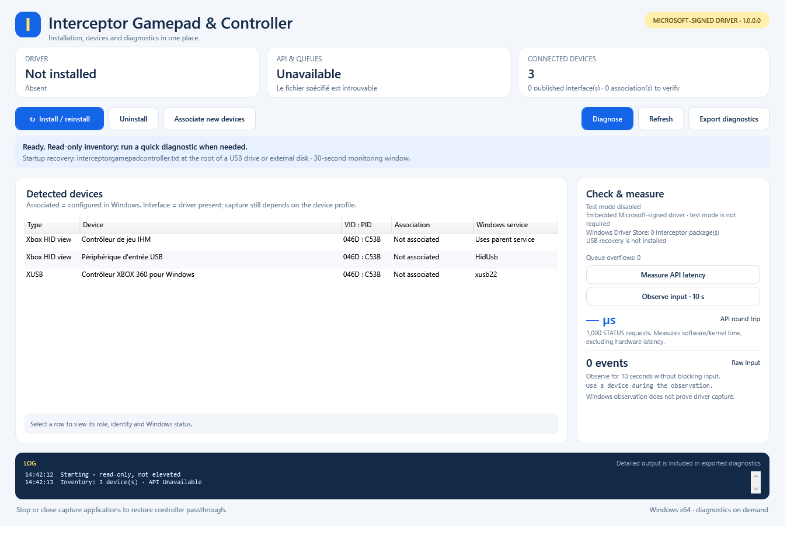
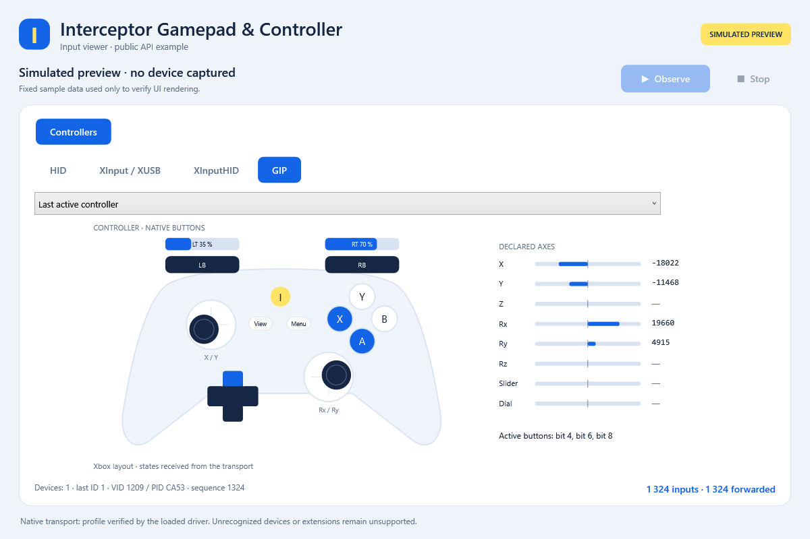

# Interceptor Gamepad & Controller - Windows Kernel Filter Driver

Capture and remap **physical gamepad/controller input** with a **Microsoft-signed
Windows kernel filter driver** and a **two-file C++17 SDK**. Supports compatible
HID, XInput/XUSB, XInputHID and GIP profiles on **Windows 10 1709+ / Windows 11 x64**.

**[Download](https://github.com/TitanCSA/Interceptor-Gamepad-Controller/releases/latest)** |
[Installation](docs/INSTALLATION.md) | [C++ API](docs/API.md) |
[Compatibility](docs/COMPATIBILITY.md) | [Examples](ExamplesConsole/README.md)

| Setup and diagnostics | Input viewer |
| --- | --- |
|  |  |

Screenshots illustrate the interface; preview controller inputs are simulated.

<a id="quick-start"></a>

## Install and use

1. Download this repository's **InterceptorSetup.exe**, run it and accept elevation.
2. Choose **Install / reinstall**. If requested, use Windows **Restart** and
   reopen setup to finish associations. Continue until no restart is requested.
3. Open **InterceptorExampleUI.exe** as administrator and click **Observe**.
   Select a controller family to inspect its input. **Stop** releases capture;
   run one capture application at a time.
4. Use **Diagnose** for per-device checks and a report you can copy or export.
   Features that were not exercised remain **unverified**.

The GUI provides **Uninstall**. The console installer uses the same setup engine:

```powershell
.\InterceptorSetupConsole.exe /install
.\InterceptorSetupConsole.exe /uninstall
```

Exit code `3010` requests a restart; rerun `/install` afterward if associations
are pending. Updating only the viewer does not update the driver. The driver's
Microsoft signature does not automatically sign installer or example EXEs.
[Installation and recovery](docs/INSTALLATION.md).

## How it works

The filter receives supported physical reports before they reach the associated
Windows input consumers. A capture application can read or change them, then
return them through the device's native path. Without a capture owner, physical
input passes through normally. Closing the application releases capture.

| Family | Input handling |
| --- | --- |
| HID | Dynamic controls decoded from the device's report descriptor |
| XInput / XUSB | Compatible wired USB source beneath the native Windows XUSB driver |
| XInputHID | Supported HID collection beneath the Windows translator |
| GIP | Compatible USB gamepad protocol, standard state and Guide input |

Compatible profiles include **DualShock 4 / DS4 (PS4), DualSense (PS5), wired
Xbox 360, Xbox One and Xbox Series X|S**. Connection, descriptor and protocol
determine support; consult the [compatibility guide](docs/COMPATIBILITY.md).
Windows can expose multiple nodes for one controller, including secondary HID
views; the setup table is not a count of physical gamepads.

For continuous **physical IN / driver OUT** inspection and script-based remapping,
use [GamePad Remapper](https://github.com/TitanCSA/GamePad-Remapper). Its passive
monitor works without a running script or capture and does not start the demo
timer. [What IN and OUT measure](docs/PASSIVE-MONITOR.md).

## C++ SDK

Add [`Interceptor.h`](Interceptor/Interceptor.h) and
[`Interceptor.cpp`](Interceptor/Interceptor.cpp) to your Windows x64 C++17 project.
Compile the source once and include the header. No Interceptor DLL or prebuilt
LIB is required; live capture requires administrator rights.

`Get_Input_With_Timeout()` automatically creates and reuses the session and
returns a batch containing the supported input families. Read or change typed
state and call `Send_Input(inputs)`. The library determines destinations, types
and counts. Forward unchanged entries too, and finish the batch before receiving
another one. [API reference](docs/API.md).

This edition handles controllers only. It can coexist with the separate
[Keyboard & Mouse edition](https://github.com/TitanCSA/Interceptor-Keyboard-Mouse),
which has its own service, SDK and demo allowance. Remove an overlapping combined
[Interceptor](https://github.com/TitanCSA/Interceptor) installation first.

<a id="downloads-and-source"></a>

## Downloads and build

The [latest release](https://github.com/TitanCSA/Interceptor-Gamepad-Controller/releases/latest)
contains **InterceptorSetup.exe**, **InterceptorSetupConsole.exe**,
**InterceptorExampleUI.exe**, complete/examples/source SDK ZIPs and
**SHA256SUMS.txt**. Use matching components from the same release.

```text
Interceptor/       Interceptor.h and Interceptor.cpp
ExamplesConsole/   Controller passthrough and decoded HID axis examples
ExamplesUI/        Graphical input viewer
InstallerConsole/  Console installer
InstallerUI/       GUI, setup engine and compiled driver/recovery binaries
docs/ licenses/    Guides, screenshots and license terms
```

Build user-mode tools with Visual Studio 2022 C++ tools, a Windows SDK and CMake:
`powershell -ExecutionPolicy Bypass -File .\Build.ps1`.
The signed driver and compiled recovery binaries are supplied; **kernel source
is not included**. [Build guide](docs/BUILD.md). User-mode source is [MIT](LICENSE);
the driver has [separate terms](licenses/BINARY-LICENSE.txt).

<a id="two-hour-demo"></a>

## Demo edition

**Two hours per Windows kernel boot**, starting with the first successful capture
and shared across this edition's applications. Sleep time counts; closing or
reinstalling does not reset it. Capture diagnostics can start the allowance.
At expiry, captures are released and capture/injection stop; physical input passes
through normally. Use Windows **Restart** for a new allowance. Passive IN / OUT
monitoring remains available and does not start or reset this timer.
For the unrestricted version, DM **`titancsa`** on Discord.

This independent project evolves the workflow popularized by
[oblitum/Interception](https://github.com/oblitum/Interception), with its own
implementation and API. It is not affiliated with oblitum or ABI-compatible with
the original. [Attribution](licenses/NOTICE).

## Minimal example: receive, read, forward

Install this edition first, restart if requested, and run your application as
administrator. Include `Interceptor.h`, compile `Interceptor.cpp` with your
application, and enable C++17. This loop forwards every received input:

```cpp
#include "Interceptor.h"
#include <iostream>
#include <system_error>

int main() try {
    using namespace Interceptor;
    const auto init = Init_AllDevices();
    if (!init.ready) {
        std::cerr << "Initialization error: " << init.error
                  << ", restart required: " << init.reboot_required << '\n';
        return 1;
    }
    for (;;) {
        auto inputs = Get_Input_With_Timeout(1000);
        for (auto& input : inputs) {
            if (auto* pad = input.Get<Controller_Hid_Input>()) {
                // Inspect pad->state.axes, triggers, hats and buttons.
                // Each declared control keeps its own descriptor identity.
                (void)pad;
            } else if (auto* xusb = input.Get<Controller_Xinput_Input>()) {
                // Example: xusb->state.left_x is the left stick X value.
                (void)xusb;
            }
            // XInputHID and GIP entries stay in this same batch too.
        }
        const auto sent = Send_Input(inputs);
        if (!sent) {
            std::cerr << "Send error: " << sent.error << '\n';
            return 1;
        }
    }
} catch (const std::system_error& error) {
    std::cerr << error.what() << '\n';
    return 1;
}
```

1. **Receive:** `Get_Input_With_Timeout(1000)` waits up to 1,000 milliseconds for
   input after initial context setup. Timeout returns an empty batch. The library
   creates and reuses the capture automatically; no context argument is needed.
2. **Read:** each `input` is one event. `input.type` gives its family, `input.device`
   its source ID within that family, and `inputs.size()` the event count.
   `input.Get<T>()` returns a pointer to that family's data or `nullptr`.
   Change typed fields before forwarding to modify an input; set
   `input.blocked = true` to block that event.
3. **Forward:** `Send_Input(inputs)` returns the batch to its source devices.
   Destination, type and count are automatic. Receiving consumes input, so
   forward unchanged entries too. `sent.accepted` gives the accepted count;
   `sent.error` is `0` on success. This basic example exits on a send error.

A batch borrows reusable storage: finish it before receiving another one.
Closing the application releases capture. See [API details](docs/API.md) for
field layouts, cancellation, errors and partial-send retries.
